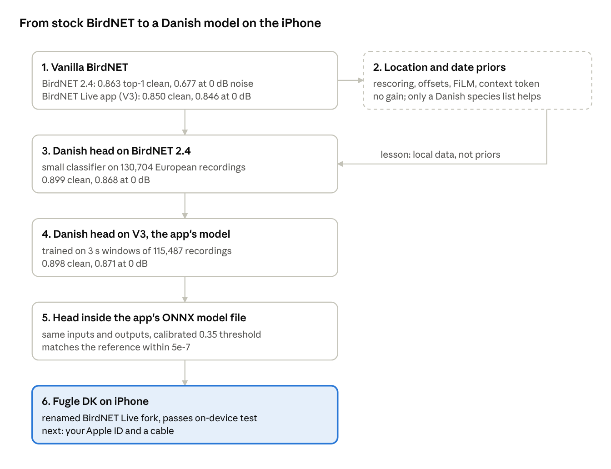
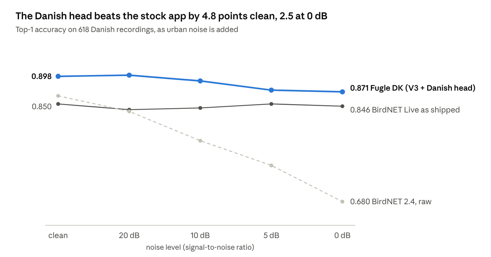

# From BirdNET to Fugle DK

Oct 15, 2026 · @Nico Rapin

*Copy of the shared doc of the same name (2026-10-15); the doc is the version to edit.*

We took stock BirdNET, showed that adding location and date priors does not help it, trained a small Danish classifier head that does, rebuilt that head for the model inside the BirdNET Live phone app, and packaged it as an iPhone app, Fugle DK. On 618 Danish recordings, the app with the Danish head names the right species 89.8% of the time, against 85.0% for the app as shipped.

## At a glance



Priors were the first idea and a dead end; what carried every later step is a small head trained on local recordings, first for BirdNET 2.4, then rebuilt for the app's model.

## 1. Starting point: vanilla BirdNET

Stock BirdNET already names the species in about 86% of Danish recordings; everything below is measured against that.

**Two BirdNETs matter here.**

|  | BirdNET 2.4 | BirdNET+ V3.0-preview3.1 |
| --- | --- | --- |
| Where it runs | BirdNET-Analyzer, most research tools | the BirdNET Live phone app |
| Format | TensorFlow / TFLite | ONNX, FP16, 67 MB |
| Input | 3 s at 48 kHz | 3 s windows at 32 kHz |
| Species | 6,522 | 9,789 (birds, amphibians, mammals, insects) |
| Embedding | 1,024 numbers per chunk | 1,280 numbers per window |
| Location filter | eBird-based species list | a separate geo-model: species score at lat, lon, week |

Both work the same way inside: a large network turns 3 s of audio into an **embedding** (a list of numbers describing the sound), and one final layer turns the embedding into a score per species. For V3 we verified that final layer exactly: score = sigmoid(W · embedding + b). That is what lets us bolt our own layer on later without retraining the big network.

**How the app scores a file.** It cuts the audio into non-overlapping 3 s windows, scores each window, and reports a species when its score passes 0.35. By default it first removes species the geo-model gives less than 0.03 at your location and week. For a whole recording we take the best window per species, then the top species.

**The Danish test set, DKX.** No public test set is Danish, so we built one from Xeno-canto: Danish recordings uploaded from 2025-01-01, quality A–C, none of them in BirdSet's training data. That gives 622 recordings, 181 species and 36 recordists. Uploads from 2025 onward are the ones BirdNET 2.4 cannot have trained on. Confidence intervals resample recordists, so one prolific recordist cannot carry a result.

**DKXN, the noisy copy.** The same 622 recordings with urban and outdoor noise mixed in at 20, 10, 5 and 0 dB signal-to-noise: engines, car horns, trains, sirens, aircraft, helicopters, church bells, footsteps, wind and rain (ESC-50, test fold only, clips where BirdNET hears a bird removed).

**Baseline, top-1 on DKX:**

| model, as scored | clean | 0 dB noise |
| --- | --- | --- |
| BirdNET 2.4 | 0.863 | 0.677 |
| BirdNET 2.4 + Danish species list | 0.875 | 0.820 |
| BirdNET Live app as shipped (V3 + geo filter) | 0.850 | 0.846 |

BirdNET 2.4 collapses in noise, mostly by drifting to non-European species. V3 hardly notices noise.

## 2. What did not work: telling BirdNET where and when

Knowing where and when a recording was made does not make a strong classifier better; that is the main research result, written up as a negative-result paper.

The idea was natural: a January recording from a Danish garden should not score a summer migrant highly. We built a **prior**, P(species | place, week), from 2 billion eBird records on an H3 hexagon grid, and for Denmark a second one from DOFbasen (34 million observations before 2025). Every method was run against controls that keep the prior's shape but scramble its information: uniform, species frequency only, places shuffled, weeks shuffled.

| phase | what we tried | result |
| --- | --- | --- |
| B | Combine BirdNET 2.4 and Perch 2.0 scores with the prior: Bayesian rescoring, learned offsets, a fusion network (6 American test sets, 5 seeds) | Best case +0.003 cmAP for BirdNET; Perch loses up to 0.14 |
| C | Train the prior into the network itself (FiLM layers, a context token) on BirdSet ConvNeXt and AST, each against an identical unconditioned twin; 190 + 55 GPU runs | −0.017 to +0.004 cmAP; FiLM × ConvNeXt significantly worse (p < 0.001) |
| — | On DKX: rescore BirdNET with the Danish DOF prior | Top-1 falls from 0.864 to 0.649 |
| — | On DKX: use DOF only as a list, dropping species never recorded in Denmark | Top-1 rises to 0.879 (+0.015) |

The prior does carry real information: it beats its own place-shuffled copy by up to 0.1 cmAP. But a strong acoustic model already recovers that information from the sound, and multiplying its sharp scores by a smooth prior mostly demotes the right answer. Locally it goes wrong in sparse cells: a Pink-footed Goose became a Grey Heron because DOF had few goose records in that hexagon and week.

**What we kept:** the Danish species list as a coarse filter, and the conclusion that local knowledge has to come from local training data, not from occurrence probabilities.

## 3. What worked: a Danish head on BirdNET 2.4

A small extra layer trained on European recordings and multiplied into BirdNET's own scores lifts Danish top-1 from 0.863 to 0.899 on clean audio and from 0.677 to 0.868 in heavy noise.

**The head.** BirdNET's big network stays frozen. We take its embedding of each recording and train a small classifier on it: either one linear layer or a two-layer network, outputting probabilities q over about 390 European species. It costs minutes on a CPU, not GPU days.

**The fusion.** The head does not replace BirdNET, it re-weights it. Per species:

```latex
\text{fused} = \log s_{\text{BirdNET}} + \alpha \, \log q_{\text{head}}
```

BirdNET keeps its say; a species the head finds unlikely (or has never seen, which gets a floor of q = 0.0001) is pushed down. α sets how much the head counts.

**Training data.**

- Xeno-canto recordings in BirdSet's XCL inside a European box (lat 46–71.5°, lon −11 to 32°).
- All 36 DKX recordists removed, so nobody appears in both training and test.
- Labels mapped onto BirdNET's species by scientific name; without that, 4,538 recordings of 42 renamed species were silently lost. 4,380 more that an earlier step had dropped as “undated” were embedded separately.
- 130,704 labelled recordings. The newest 10% by Xeno-canto ID (2023 onward) are held out for choosing the model; BirdNET itself only gets 0.768 on them.
- Species with at least 5 training recordings: 389, covering 99.2% of DKX's species.

**Model choice** used only that held-out set: linear vs two-layer, four weight-decay/learning-rate pairs, α from 0.25 to 4. DKX was scored once, after the choice.

**Results (head v4; CIs resample recordists, paired):**

| noise | BirdNET 2.4 | + Danish species list | + Danish head | head vs BirdNET \[95% CI\] |
| --- | --- | --- | --- | --- |
| clean | 0.863 | 0.875 | **0.899** | +0.035 \[−0.007, +0.058\] |
| 20 dB | 0.836 | 0.862 | **0.897** | +0.061 \[+0.010, +0.086\] |
| 10 dB | 0.786 | 0.842 | **0.894** | +0.108 \[+0.056, +0.130\] |
| 5 dB | 0.741 | 0.838 | **0.873** | +0.132 \[+0.066, +0.169\] |
| 0 dB | 0.677 | 0.820 | **0.868** | +0.191 \[+0.115, +0.224\] |

The head never heard noisy audio, yet it loses only 3 points from clean to 0 dB where BirdNET loses 19. A second head (v5) trained on noisy copies of all training recordings (car, train, siren, wind… at 0–20 dB) ties v4 everywhere: the robustness comes from the head, not from noise training.

**Where BirdNET goes wrong on DKX:** of its 85 errors, 25 name a background bird that really is in the recording, 25 name a species never seen in Denmark, only 4 confuse two species of one genus, and in 27 the right answer is not in its top 5. These are recognition failures, which is why a better decision layer on the same embeddings helps.

The v5 head was also exported as one TensorFlow / TFLite model for BirdNET-Analyzer (0.904 whole-recording top-1). But the phone app does not run BirdNET 2.4, so that export cannot go into it.

## 4. Moving to the app's model: a head for BirdNET+ V3

The same recipe works on V3, the model inside BirdNET Live: a head trained on V3's 3 s windows reaches 0.898 top-1, matching the BirdNET 2.4 head in a model the app can run.

**Why retrain.** A head reads one model's embeddings. V3's embeddings (1,280 numbers at 32 kHz) mean nothing to a head trained on 2.4's (1,024 numbers at 48 kHz), and the species lists differ. So the V3 head is a new head, trained from scratch on V3 embeddings.

**Step 1: embed every training recording with V3.** We ran V3 (ONNX) on the GPU cluster over all European recordings, up to 100 windows (5 min) each, storing one embedding per 3 s window: 134,000 recordings, 98 shards.

- **NaN on silence.** V3 returns NaN for a window of pure digital silence, and some Xeno-canto files are padded with it. Those windows are now skipped.
- **The 15-hour problem.** The first pass ran at 7 windows per second on an H100. Profiling showed why: every recording sent a batch of a different size, and the GPU is slow whenever the input shape changes. Packing windows from many recordings into fixed batches of 64 gave 139 windows per second; one test shard went from 221 s to 14 s and the whole pass finished in about an hour.
- **Check:** the fast pass picks the same top species as the slow one on 99.85% of windows (2 of 1,356 differ, from GPU half-precision rounding).

**Step 2: train on windows, not recordings.** The app judges each 3 s window, so the head is trained on windows too. A Xeno-canto label only says the bird is somewhere in the file, so each recording contributes its 3 windows where V3 itself rates the labelled species highest: where the bird most likely calls. That gives 312,453 windows from 115,487 recordings, 379 species.

**Step 3: choose like the app scores.** Each candidate head (linear or two-layer, two learning rates, α from 0.25 to 2) is fused per window, then the best window per species decides, exactly as the app does. Chosen: a linear head with α = 2. On the held-out newest recordings it reaches 0.863 top-1 against V3's own 0.817.

**Result on DKX:** 0.898 clean, against 0.850 for the app as shipped; +0.049 \[+0.031, +0.085\], and significant down to 10 dB. Below that the app's model is already so robust that the gain (+0.024) is no longer certain. Full numbers in the results section.

## 5. Packaging the head for the app

The head now lives inside the app's own model file, so the app runs it without any code change: only the model file and its config file are swapped.

**Graph surgery.** The app has no way to load a second model, so the head is appended to V3's ONNX graph (69 MB, +2 MB). The new file keeps the app's interface:

| output | original model | Danish model |
| --- | --- | --- |
| `predictions` | V3's 9,789 species scores | the fused Danish scores |
| `embeddings_out` | 1,280-number embedding | unchanged |
| `birdnet_predictions` | — | V3's original scores, kept for comparison |

**Keeping the 0.35 threshold meaningful.** The app only shows species scoring ≥ 0.35, so the fused number has to look like a probability.

1. A first version (`norm`) rescaled each window so its favourite species kept V3's score. The threshold behaved, but accuracy fell to 0.858: a noisy window where the head is unsure got the same weight as a clear call.
2. The final version (`cal`) is sigmoid(log s + α log q + b). It ranks species and windows exactly like the 0.898 fusion. The offset b = 2.94 was set on the held-out training data so that as many recordings pass 0.35 as with V3 alone. On DKX 97.9% of recordings have a detection above threshold, against 96.4% for the app as shipped.

**Model updates reach phones.** The app caches its model under the file name plus the version string, so the version now carries the head's name (`3.0-preview3.1-dk.v3_head_v2`). A future head will replace the cached copy instead of being ignored.

**Checks:**

- On real Danish audio, the new file's `birdnet_predictions` and `embeddings_out` equal the original model's exactly, and `predictions` matches a NumPy re-implementation within 5 × 10⁻⁷.
- The file is byte-identical on the cluster and the Mac (SHA-256 91b6a562…) and runs on CPU there.
- 59 unit tests pass on the cluster.

## 6. The iPhone app: Fugle DK

Fugle DK is a fork of BirdNET Live with the Danish model inside; it builds, runs in the iOS simulator and passes an on-device model test, and is one Apple ID and one cable away from a real iPhone.

**Why a fork.** BirdNET Live (Flutter, MIT licence; model weights Apache-2.0) bundles its model and cannot load another at runtime. Its acceptable-use policy asks derivatives to use their own name, so ours is a renamed fork.

**What changed in the fork** (`~/Documents/repo/fugle-dk`, branch `danish`):

| change | why |
| --- | --- |
| Name “Fugle DK”, bundle ID `dk.birdology.fugledk` | the upstream policy; also lets it sit beside the real app |
| “Fugle DK” in 96 UI strings and the iOS permission prompts; credits still name BirdNET Live | users see the right name; attribution stays honest |
| App Group permission removed | a free Apple ID cannot sign it, and it only served an old share feature |
| Danish model + new `model_config.json` | the actual change |
| Species filter off by default | the head already restricts to Danish species; the geo filter on top cost 1.6 points |
| Species photos and descriptions built (9,789 species) | official releases build them; without them the app shows placeholders |
| Model files stored with Git LFS | as upstream does |

**Mac setup.** Xcode 27, Flutter 3.47.7, CocoaPods, git-lfs and the iOS 27 simulator were installed. The app compiles as an unsigned release build (159 MB).

**Tested on the simulator.** A new integration test runs the app's own inference code on 6 Danish windows where the head changes BirdNET's answer (geese, Goldeneye vs swans, Cuckoo). The app reproduces the reference scores to 3 decimals and picks the head's species, not the stock one: proof that the head runs inside the app. The app also starts and shows “Welcome to Fugle DK”.

**Left to do, by you:**

- [ ] Add your Apple Account in Xcode → Settings → Accounts (free Personal Team).
- [ ] Plug in the iPhone, tap “Trust”, turn on Settings → Privacy & Security → Developer Mode.
- [ ] After the install, trust the developer under Settings → General → VPN & Device Management.

A free Apple ID install expires after 7 days (re-running the install renews it). Sharing with others through TestFlight needs the paid Apple Developer Program ($99 a year) and a new app icon, since the current one is BirdNET's.

## 7. Results



*Data: `data/phase_d/v3_dkx_head_v2.csv` (fleet), 618 DKX recordings, clean and 4 noise levels.*

The gain over the stock app is significant from clean audio down to 10 dB (+0.049 \[+0.031, +0.085\] clean, +0.060 at 20 dB, +0.047 at 10 dB); at 5 and 0 dB the intervals touch zero. BirdNET 2.4 with its own Danish head tracks Fugle DK within 0.01 at every level, and the V3 head also ranks species better overall (cmAP 0.813 against 0.757). Turning the app's geo filter on above the head costs 1.6 points, which is why Fugle DK ships with it off.

## 8. Caveats and open items

The gains are real on Danish focal recordings; the main open question is how they hold on a phone in the field.

**Caveats**

- **Focal recordings only.** DKX is recordings people chose to upload, mostly with one clear bird. Passive soundscapes and live phone audio were not tested.
- **Possible leakage for V3.** V3 may have trained on 2025 Xeno-canto uploads, i.e. on DKX itself. That would flatter the app's baseline, not the head, but both numbers carry the doubt.
- **Synthetic noise.** DKXN mixes recorded noise in at fixed ratios; real wind on a phone microphone differs.
- **Small test set.** 36 recordists make intervals wide: at 5 and 0 dB the V3 head's gain is not significant.
- **Rarities.** The head pulls rare Danish visitors toward common relatives (Pallas's Leaf Warbler, Greenish Warbler, Red-rumped Swallow), and calls Hooded Crow Carrion Crow because the training data is mostly western European.
- **Two species missing** from a label axis: Eurasian Dotterel and Little Ringed Plover (renamed taxa).
- **Live mode untested.** The test covers the model inside the app; the live microphone pipeline (temporal pooling, sensitivity) has not been checked with the head yet.

**Open items**

- [ ] Install on your iPhone (section 6) and try it on real birds.
- [ ] New app icon before sharing via TestFlight.
- [ ] Push `main` (blocked as “merge without review”; needs you) and push `feat/birdnet-app`.
- [ ] Decide where the fork lives on GitHub (not created yet).
- [ ] Fix the renamed-taxa date lookup; add a name bridge for Little Ringed Plover.
- [ ] Rarity flagging with the DOF prior, the use it is actually suited to.

## 9. Where everything lives

| what | where |
| --- | --- |
| Research code | birdology repo, branch `feat/birdnet-app` (local; `main` + Phase D merged on `merge/all-into-main`) |
| Paper draft | `docs/papers/2026-10-13-context-priors-null-result-draft.md`, §7–§8 |
| V3 code | `src/birdology/phase_d/birdnet3.py`, `export_onnx.py`; `scripts/phase_d_v3_embed.py`, `_train_head.py`, `_eval.py`, `_export.py` |
| BirdNET 2.4 head | `data/phase_d/dk_head_v5/`; TFLite export `data/phase_d/export_v5/` |
| V3 window embeddings | `data/phase_d/v3/` (DKX, DKXN, XCL\_eu; jobs 11347, 11387) |
| V3 head + app files | `data/phase_d/v3_head_v2/`, `data/phase_d/app_export_v2/` (job 11485) |
| DKX scores | `data/phase_d/v3_dkx_head_v2.csv` |
| iPhone app | `~/Documents/repo/fugle-dk`, branch `danish` (local, 6 commits on upstream 28fca2b) |
| On-device test | `integration_test/danish_model_test.dart` in the fork |

Cluster paths are under `/srv/home/rapnic/birdology` on the Gimle fleet.
